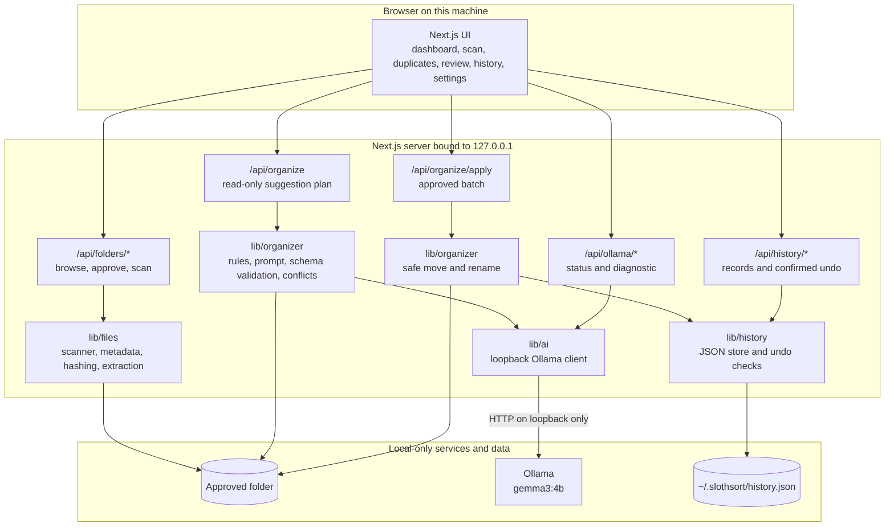

# SlothSort

**Drop the clutter. Let the sloth handle it.**

SlothSort is a privacy-first, local AI file organizer. It scans one approved
folder, finds exact duplicates with SHA-256, asks Gemma running in Ollama for
categories and filenames, and shows every proposed change for approval before
anything moves.

> **Status: working local MVP.** Scan, duplicate review, local Gemma
> suggestions, per-file review, confirmed moves and renames, local operation
> history, and supported undo are implemented. Nothing is moved, renamed, or
> deleted until you approve it and confirm the batch. This project is being
> prepared for the Hacktoberfest 2026 "Slow and Steady" open-source AI
> challenge.

## The problem

A Downloads folder becomes a dumping ground: duplicate invoices, half-renamed
receipts, screenshots, archives, and files whose names say nothing about their
contents. Cleaning it up is tedious, and the convenient alternatives usually
mean uploading personal files to a cloud service or trusting an opaque tool to
move things without asking.

## The solution

SlothSort keeps the tedious part local and keeps the human in control:

1. **Scan** one folder without changing it.
2. **Detect exact duplicates** with deterministic SHA-256 hashing.
3. **Suggest** a category, filename, destination, and short reason with a local
   Gemma model.
4. **Review** every suggestion, warning, and uncertainty.
5. **Apply** only explicitly approved moves and renames.
6. **Undo** a supported batch while the files are still in their recorded state.

The model is a helper, not an authority. Deterministic code handles hashes,
paths, destination rules, collisions, and file identity. The model only proposes
the classification and name.

## Why local, open-weight AI is central

Gemma 3 4B through Ollama performs the meaningful classification and naming
work. It is not a decorative label: the suggestion plan is generated from the
local model's structured JSON reply, then validated with Zod before it can reach
the review screen.

Running the model locally matters for this product because the input is
personal files. SlothSort does not include a cloud AI client or a silent cloud
fallback. The Ollama endpoint is required to be loopback, and the server refuses
a non-loopback URL before sending a prompt. That behavior is covered by tests.

## What works today

| Area | What is implemented |
| --- | --- |
| Folder access | Local folder browser, canonicalized approval, opaque folder id, read-only scans |
| Scanning | File metadata table, subfolders, unreadable/unsupported reporting, cancelable progress |
| Duplicates | SHA-256 exact groups, similar-name groups kept separate, hashing failures |
| Local AI | Ollama status, installed-model check, validated diagnostic, per-file suggestions |
| Suggestions | Category, filename, destination, reason, uncertainty, warnings, extraction status |
| Review | Per-file approve/reject, filters, low-risk batch selection, explicit apply confirmation |
| Organization | Safe moves/renames, destination creation, collision refusal, per-file results |
| History | Local JSON records written before the first move, newest-first list, per-file outcomes |
| Undo | Verified restore in reverse order, conservative refusal when data changed |
| Appearance | Responsive layout, light/dark/system theme, keyboard-visible focus styles |
| Privacy | Loopback-only Ollama endpoint, no analytics client, no cloud AI fallback |

### Deliberately not implemented

These are outside the MVP and should not be inferred from the UI:

- automatic file deletion
- automatic conflict renaming or overwriting
- OCR or image-content analysis
- spreadsheet, presentation, or legacy `.doc` text extraction
- semantic or near-duplicate detection
- scheduled or background file changes
- multiple-folder batch organization at once
- user accounts, cloud sync, billing, or team collaboration
- in-app model switching (set `OLLAMA_MODEL` and restart)
- model accuracy, speed, or benchmark dashboards

## Demo

The full walkthrough is in [`docs/DEMO.md`](docs/DEMO.md), with a capture
checklist in [`docs/DEMO-CHECKLIST.md`](docs/DEMO-CHECKLIST.md).

Create a synthetic messy folder:

```bash
node scripts/create-demo-folder.mjs
```

The default target is `demo/slothsort-demo/` and is ignored by git. The script
uses only Node built-ins, creates valid synthetic PDF/DOCX/ZIP files, and never
deletes anything. It refuses a non-empty folder unless every entry is one of its
own generated names; `--force` only overwrites those generated files.

The folder demonstrates:

- two exact duplicate invoices
- two exact duplicate receipts in different subfolders
- two similar-name SVG images with different contents
- valid DOCX, PDF, CSV, Markdown, and ZIP files
- one unknown `.xyz` file that is reported as unsupported

For screenshots or a recording, create the folder outside your home directory so
your user name is not visible, for example:

```powershell
node scripts/create-demo-folder.mjs C:\Users\Public\SlothSortDemo
```

```bash
# macOS
node scripts/create-demo-folder.mjs /Users/Shared/SlothSortDemo
# Linux
node scripts/create-demo-folder.mjs /tmp/slothsort-demo
```

Then start the app, choose that folder, and follow the walkthrough. The model may
suggest different names or destinations on different runs; approve only what
makes sense.

## Architecture

SlothSort is a single local Next.js application. The browser talks only to the
app's own Route Handlers. Filesystem access and inference stay in server-side
modules.



### Module responsibilities

| Module | Responsibility |
| --- | --- |
| `lib/files/` | Scanning, metadata, extension-based kinds, SHA-256 hashing, bounded text extraction, path safety |
| `lib/ai/` | Ollama client, status checks, diagnostic prompt, response validation |
| `lib/organizer/` | Fixed destination rules, prompt, sanitization, conflict checks, planning, safe moves |
| `lib/history/` | Local JSON history, atomic writes, undo preflight and restore |
| `lib/workspace/` | UI-facing review, plan mapping, apply and undo clients, summaries |
| `lib/validation/` | Shared Zod schemas for inputs and model output |
| `lib/server/` | Loopback/origin checks, request limits, API response helpers |
| `app/api/` | Route Handlers that connect the UI to the server modules |
| `components/` | Reusable UI, including shadcn/ui primitives |

## Technology stack

| Layer | Choice |
| --- | --- |
| App | Next.js 16.4.2 App Router, React 19.3, Turbopack |
| Language | TypeScript 5 in strict mode |
| UI | Tailwind CSS 4, shadcn/ui, Lucide icons |
| Validation | Zod 4 |
| Local AI | Ollama with `gemma3:4b` |
| Text extraction | `pdf-parse` for PDFs, Mammoth for DOCX, bounded UTF-8 reads for text |
| Hashing | Node.js `crypto` SHA-256 |
| History | Local JSON file under `~/.slothsort` |
| Tests | Vitest 5 |

## Requirements

- **Node.js 22.12 or newer.** The project was developed and verified with Node
  `24.21.0`.
- **npm 11** (verified with `11.19.0`).
- **Ollama** on the same machine.
- Enough disk space for the model (about 3.4 GB for `gemma3:4b`) and enough
  memory for Ollama to run it. SlothSort does not set a hardware benchmark; the
  machine must be able to run the model in Ollama.

The app is intended for a local desktop browser. It binds the dev and start
servers to `127.0.0.1` on purpose.

## Install Ollama and Gemma

1. Install Ollama from <https://ollama.com/download> using the installer or
   package instructions for your operating system.
2. Confirm the CLI is available:

   ```bash
   ollama --version
   ```

   The project was verified with Ollama `0.40.4`.

3. Make sure the Ollama service is running. The desktop app normally starts it;
   if needed, run:

   ```bash
   ollama serve
   ```

4. Pull the default model once. This step needs internet access:

   ```bash
   ollama pull gemma3:4b
   ollama list
   ```

5. Optionally inspect the installed model:

   ```bash
   ollama show gemma3:4b
   ```

   On the verification machine this reported:

   - architecture: `gemma3`
   - parameters: `3.9B`
   - quantization: `Q4_K_M`
   - context length: `131072`
   - capabilities: completion and vision
   - disk size reported by `ollama list`: `3.4 GB`

   SlothSort does not use the model's vision capability. Images are classified
   from metadata only.

The app uses `POST /api/chat` with `stream: false` and a JSON Schema in `format`.
Older Ollama builds without structured output fail safely with a visible error;
they are not silently accepted.

## Run SlothSort locally

From the project folder:

```bash
npm ci
npm run dev
```

Open <http://127.0.0.1:3000>.

For a production build:

```bash
npm run build
npm run start
```

`npm run typecheck` runs `next typegen` first and then `tsc --noEmit`, so it also
works from a fresh checkout where `.next/types` does not exist yet.

### Configuration

Configuration is optional because the defaults point at local Ollama. To change
them, copy `.env.example` to `.env.local`:

```bash
cp .env.example .env.local
```

| Variable | Default | Purpose |
| --- | --- | --- |
| `OLLAMA_BASE_URL` | `http://127.0.0.1:11434` | Local Ollama API endpoint. A non-loopback URL is refused before a prompt is sent. |
| `OLLAMA_MODEL` | `gemma3:4b` | Installed model name. Change it and restart; there is no in-app model switcher. |
| `SLOTHSORT_HISTORY_DIR` | `~/.slothsort` | Local history folder. Relative values resolve against the server's working directory. UNC/device paths are refused on Windows. |
| `NEXT_TELEMETRY_DISABLED` | `1` in `.env.example` | Stops the Next.js CLI from sending anonymous build/dev telemetry. |

Do not commit `.env.local` or any other environment file. Only `.env.example`
is tracked.

## Usage guide

### 1. Choose a folder

Use the dashboard or **Folder scan** page and click **Choose folder**. The app
opens its own local folder browser. Drive roots, UNC/device paths, system
folders, the whole home folder, and its immediate parent are refused.

The server canonicalizes the chosen folder with `realpath`, checks that it is a
readable directory, and stores an opaque approval id in process memory. The scan
request references that id, not an arbitrary path supplied by the browser.
Approvals expire when the server restarts or after 12 hours.

Choosing a folder starts a scan automatically. **Scan again** repeats it.

### 2. Scan and inspect files

The scan reads directory entries and `lstat` metadata. It does not modify files.
It shows filename, extension, size, modified date, detected kind, MIME type, and
warnings. Unreadable files and folders are skipped and reported.

A scan stops at 10,000 files, 2,000 folders, or 12 levels of depth and explains
why. Symbolic links and junctions are skipped. Progress streams to the browser,
and **Cancel scan** aborts the server-side walk.

### 3. Review exact duplicates

Duplicate detection runs after the metadata walk and is independent of the
model:

1. Files are grouped by size. A file with a unique size is never read for
   hashing.
2. Size-shared candidates are hashed with SHA-256, up to 16 MB per file, four at
   a time.
3. Each candidate is revalidated immediately before reading. Missing files,
   symlinks, paths outside the approved folder, and files whose size or
   modification time changed are reported as failures.
4. A file is checked again after hashing; a digest for a changed file is
   discarded.
5. An exact group requires both a matching SHA-256 and a matching size.

The **Duplicates** page shows exact groups with relative paths, sizes,
modification dates, and hashes. It also has a separate **similar names** section
for files whose names look alike but whose contents differ. Nothing on that page
deletes or moves a file; choosing a copy to keep is a preview only.

### 4. Generate local suggestions

Open **Review** and click **Generate suggestions**. The app asks the local model
for one suggestion per supported file. Generating a plan never changes a file.

The plan is streamed as newline-delimited JSON with progress, completion,
cancellation, and error events. Cancelling aborts the request and in-flight
inference.

Current planning limits:

- up to 24 supported files per run
- two model requests in flight
- two attempts per file
- 90-second timeout per request
- at most 500 requested paths in one API call
- up to 50 operations in one apply batch

The server rebuilds each file's metadata from disk instead of trusting the
browser. Requested paths must stay inside the approved folder. Symlinks and
files that disappeared after the scan are skipped.

The model receives the filename, extension, size, modified date, detected kind,
MIME type, extraction status, and at most 3,000 characters of extracted text.
The fixed system prompt marks file data as untrusted. The model has no tools,
filesystem access, or command ability.

### 5. Review and approve

Each suggestion shows the original and proposed relative paths, category,
filename, destination, reason, uncertainty, and warnings. You can approve or
reject suggestions individually. **Approve selected** is limited to
low-uncertainty suggestions with no warnings; everything else requires an
individual decision.

Click **Apply approved changes**. A confirmation dialog lists every source and
destination that will be touched. Nothing runs until you confirm.

The server:

- resolves the folder from the opaque approval id
- serializes new batches against other file operations in the same process
- preflights every operation before the first move
- rejects duplicate selections and two operations targeting the same destination
- checks the destination immediately before each move and never overwrites an
  existing file
- verifies the file is unchanged since the preview using size, modification
  time, and SHA-256 where available
- moves with an exclusive hard link, or `COPYFILE_EXCL` plus a hash comparison
  when linking is not possible; `fs.rename` is never used
- removes the source only after the new file is verified
- records per-file outcomes and reports partial failures honestly

A destination collision fails that operation and asks you to review the name.
SlothSort does not invent a conflict rename for you.

### 6. History and undo

History is stored locally at `~/.slothsort/history.json` unless
`SLOTHSORT_HISTORY_DIR` is set. The folder is requested with owner-only
permissions (`mode: 0o700`); Windows ACL behavior is controlled by the operating
system and is not changed by that Node option. Writes are atomic (temp file plus
rename), and the newest 200 batches are kept.

A record is written before the first file moves and updated after every
operation, so an interrupted batch still leaves an accurate, clearly incomplete
record. Absolute root paths stay in that server-side file; history payloads
sent to the browser use relative paths.

**History** shows each batch, per-file outcomes, the note, and whether undo is
available. Undo (`POST /api/history/:id/undo` with an explicit `confirmed: true`
body) restores supported moves and renames in reverse order.

Undo refuses the whole batch when:

- the record is incomplete, already undone, or a previous undo did not finish
- a moved file is missing, or its contents, size, or modification time changed
- an original path is now occupied by a different file
- the approved folder is no longer the same canonical directory, or a path
  segment became a symbolic link
- the original file identity was not fully recorded

A refusal changes nothing and explains why. Undo never deletes newer data to
make room, and it cannot restore a file another application edited, moved, or
deleted.

### 7. Settings

**Settings** shows the configured Ollama endpoint and model, the connection
state, installed models, and the Ollama runtime version. **Run test prompt**
sends one fixed, synthetic classification request and displays the validated
result. It does not read the demo folder or any personal file.

The same page shows the current safety rules and the light/dark/system theme
control. Model switching is not implemented; set `OLLAMA_MODEL` and restart.

## Supported file types and limits

SlothSort lists any regular file it can read. Extension-based detection decides
whether a file is a document, image, archive, or unsupported `other` file.

| Category | Extensions | AI suggestion? | Text extraction? |
| --- | --- | --- | --- |
| Text-like documents | `.txt`, `.md`, `.markdown`, `.csv`, `.json`, `.log`, `.yml`, `.yaml`, `.toml`, `.xml`, `.html`, `.htm` | Yes | Yes, UTF-8 up to 3,000 characters |
| Text-like code/config | `text/*` MIME types such as `.js`, `.ts`, `.css`, `.py`, `.java`, `.go`, `.rs`, `.c`, `.h`, `.cpp`, `.hpp`, `.ps1`, `.bat`, `.cmd`, plus `.sql` | Yes | Yes, up to 3,000 characters |
| PDF | `.pdf` | Yes | First 6 pages, up to 3,000 characters |
| DOCX | `.docx` | Yes | Mammoth body text, up to 3,000 characters |
| Other office documents | `.doc`, `.odt`, `.rtf`, `.tex`, `.epub`, `.pages`, `.xls`, `.xlsx`, `.ods`, `.numbers`, `.ppt`, `.pptx`, `.odp`, `.key` | Yes | No; metadata only |
| Images | `.jpg`, `.jpeg`, `.png`, `.gif`, `.webp`, `.svg`, `.bmp`, `.tif`, `.tiff`, `.heic`, `.heif`, `.avif`, `.ico`, `.psd` | Yes | No; metadata only |
| Archives | `.zip`, `.rar`, `.7z`, `.tar`, `.gz`, `.bz2`, `.xz`, `.zst`, `.iso`, `.dmg`, `.pkg`, `.deb`, `.rpm`, `.apk` | Yes | No; archive contents are not opened |
| Unsupported | executables, audio, video, fonts, unknown extensions, and anything not detected above | No; skipped without a model call | No |

Extraction limits:

- files larger than 10 MB are not read
- text output is capped at 3,000 characters
- PDFs are limited to the first 6 pages
- extraction stops after 8 seconds
- statuses are `extracted`, `empty`, `not-needed`, `unsupported`, `too-large`, or
  `failed`
- a failed extraction is reported, not treated as empty content

MIME types come from the file extension only. SlothSort does not sniff contents
during a scan.

## AI validation and safety rules

- Accepted categories and destinations are a fixed allowlist in
  `lib/organizer/rules.ts`. The model must choose one of the allowed
  destinations for its category; matching is case-insensitive, but the canonical
  spelling is stored.
- Replies must match the strict Zod schema: exactly the expected fields, a valid
  category, a safe single filename, a relative destination, and low/medium/high
  uncertainty. Extra fields, absolute paths, drive letters, and `..` are
  rejected.
- Filenames are sanitized deterministically. The original extension is
  preserved; a changed extension is rejected, and a missing extension is
  restored from the original file.
- Bidirectional formatting overrides and zero-width formatting characters are
  stripped and rejected, so an invisible character cannot disguise a name.
- SHA-256 hashes, duplicate grouping, destination conflict checks, and file
  identity are plain code. The model never decides those.
- Each entry ends as `ready`, `needs-review`, `skipped`, or `failed`. Only
  `ready` entries are eligible for bulk approval.
- The model never receives an absolute path. It cannot choose one, and apply-time
  destinations must resolve to the fixed allowlist inside the approved folder.
- There is no shell or command execution path in the app.

## Filesystem safety

Filesystem safety is a product requirement, not a post-processing check.

- Scanning is read-only. It does not rename, move, or delete anything.
- The approved root is canonicalized and revalidated. Paths outside it are
  rejected.
- Symbolic links and junctions are skipped during scans and refused at apply
  time.
- An existing destination file is never overwritten silently. A collision fails
  that operation.
- Moves use an exclusive hard link or an exclusive copy plus a hash check.
  `fs.rename` is not used.
- The source is removed only after the new file is verified.
- If a move fails midway, the partial destination is removed and the source is
  left in place.
- A record is written before the first move, so a partial batch is visible.
- Undo is deliberately conservative and refuses the whole batch if anything has
  changed.
- SlothSort has no delete feature. A source path is removed only as the final
  step of a verified move, never on its own.
- A batch is serialized against other file operations in the same process.

## Privacy and offline behavior

SlothSort is designed to keep file data on the machine:

- The AI client only talks to a loopback Ollama endpoint. A non-loopback
  `OLLAMA_BASE_URL` is refused before a prompt is sent.
- No external AI provider or cloud fallback is implemented.
- No analytics client is included.
- Prompts, model replies, filenames, and full paths are not logged.
- The model sees only the metadata and bounded text described above, never an
  absolute path.
- The browser never talks to Ollama directly.
- History stays in a local JSON file. UNC/device paths are refused on Windows.

### What needs internet access

| Step | Internet needed? | Notes |
| --- | --- | --- |
| `npm ci` / `npm install` | Yes, unless packages are already cached | Downloads Node dependencies from the npm registry |
| Install Ollama | Yes | One-time download from ollama.com |
| `ollama pull gemma3:4b` | Yes | One-time model download, about 3.4 GB |
| `npm run build` | No, after `npm ci` | Uses installed packages. Next.js may send anonymous telemetry unless `NEXT_TELEMETRY_DISABLED=1`; the app itself has no external runtime assets. |
| Scan, hash, duplicate review | No | All local filesystem and CPU work |
| Local Gemma suggestions | No, after setup | Requests go to the local Ollama service over loopback |
| Review, apply, history, undo | No | Local server and filesystem |
| App runtime UI | No external fonts/scripts are used | The app has no external runtime asset dependency in its source |

**Verification status:** the loopback-only endpoint behavior is enforced in code
and covered by tests. A full air-gapped run has not been recorded in this
repository. Treat "works offline after setup" as the intended design and a
code-verified property, not as an audited network-isolation claim. Ollama and
Next.js are separate tools with their own update/telemetry behavior; set
`NEXT_TELEMETRY_DISABLED=1` and review your Ollama configuration if you need a
strict offline environment.

## Model limitations

Gemma 3 4B is a small local model. It can be useful and it can be wrong.

- Suggestions are probabilistic. The same file can receive a different name or
  destination on another run.
- It may choose a plausible but imperfect destination. In the synthetic
  end-to-end run recorded in [`docs/TEST-REPORT.md`](docs/TEST-REPORT.md), one
  budget CSV was proposed for `Finance/Invoices`. That is exactly why every
  suggestion is reviewed before applying.
- Images and archives are classified from metadata only. SlothSort does not
  inspect pixels or archive contents, even though the Ollama model has a vision
  capability.
- Unsupported office formats, legacy `.doc`, spreadsheets, and presentations
  have no text extraction. Their suggestions use names and metadata only.
- PDF extraction is limited to the first 6 pages and 3,000 characters; long
  documents may lose important context.
- There is no OCR, semantic duplicate detection, or near-duplicate matching.
- The model never computes hashes, resolves paths, or executes file operations.
- No accuracy, speed, or quality benchmark is claimed. The test suite checks
  behavior and safety, not model quality.
- A failed or malformed model reply is rejected. There is no silent fallback to
  a cloud model or a guessed result.

## Verification

These checks were run on Windows with Node `24.21.0`, npm `11.19.0`, Ollama
`0.40.4`, and `gemma3:4b` (3.4 GB, Q4_K_M). Exact commands and additional
details are in [`docs/TEST-REPORT.md`](docs/TEST-REPORT.md).

| Check | Result |
| --- | --- |
| `npm test` | 281 passed, 3 skipped (284 tests; 21 test files passed, 1 skipped) |
| `npm run typecheck` | Passed (`next typegen` + `tsc --noEmit`) |
| `npm run lint` | Passed |
| `npm run build` | Passed; 16 app routes generated |
| Opt-in real-model integration test | 1 passed against local `gemma3:4b` |
| Clean source copy + `npm ci` | Installed successfully; typecheck, tests, and production build passed |
| HTTP end-to-end smoke on a production build | Scan, plan, apply, history, and undo all passed on the synthetic demo folder |

The end-to-end smoke run observed:

- 13 scanned files: 8 documents, 2 images, 2 archives, 1 unsupported
- 2 exact duplicate groups and 1 similar-name group
- 0 hashing failures, scan not truncated
- 12 proposed changes from 13 files; 1 unsupported file skipped; 0 model
  failures
- 1 approved file moved and recorded in history
- undo restored the file and removed the new destination
- duplicate copies and the unsupported file were still present throughout

### Repository hygiene

A final scan of tracked and non-ignored files found no matches for the
developer's actual home or temporary path and no common secret patterns. The
only environment file in the repository is `.env.example`; `.env*` is ignored
except for that example. The generated `demo/slothsort-demo/` folder is ignored,
and the tracked demo documentation describes synthetic files only.

### What was not verified

- a full air-gapped network trace or firewall-isolated run
- a manual click-through of every UI state in a real browser (the core workflow
  was exercised over HTTP; screenshots and recording are still to be captured)
- macOS and Linux behavior on real hardware
- a real personal Downloads folder (testing used synthetic files and temporary
  directories only)
- accessibility audit with a screen reader or automated axe pass
- large-folder performance or model quality benchmarks
- dependency vulnerability exploitation paths (see the dependency note below)

## Tests

```bash
npm test
```

The automated suites cover:

- path traversal, symlink/junction refusal, approved-root boundaries, and
  filename sanitization
- read-only scanning, metadata, unreadable entries, scan limits, and cancellation
- deterministic SHA-256 duplicate detection, same-size/different-content files,
  similar names, disappeared files, and files changed during hashing
- Ollama status, model-missing and unreachable states, malformed JSON, schema
  violations, extension preservation, timeouts, and non-loopback refusal
- prompt-injection text treated as data, fixed category/destination rules, and
  model response validation
- destination collisions, existing files, partial failures, cancellation, and
  files outside the approved batch
- history persistence, corrupt records, relative browser payloads, and undo
  refusal conditions
- bounded text extraction for text, PDF, and DOCX files

The real-model test is opt-in and skipped by default:

```bash
SLOTHSORT_OLLAMA_INTEGRATION=1 npx vitest run tests/integration-ollama-planner.test.ts
```

On PowerShell:

```powershell
$env:SLOTHSORT_OLLAMA_INTEGRATION = "1"
npx vitest run tests/integration-ollama-planner.test.ts
```

It requires Ollama with `gemma3:4b` installed. The verification run took about
45 seconds on the test machine; that is test execution time, not a model
benchmark.

### Dependency note

`npm ci` currently reports dependency advisories in the development tree. A
production-only audit (`npm audit --omit=dev`) reported 3 moderate advisories in
`mammoth`'s transitive `argparse`/`sprintf-js` chain. No dependency upgrade or
exploit assessment was performed for this submission. Do not treat the
dependency tree as security-audited.

## Project structure

```text
app/                  Pages and Route Handlers
app/api/folders/      Local browse, approval, and streaming scan endpoints
app/api/organize/     Streaming suggestion plan and approved-batch apply endpoints
app/api/history/      Local operation history and confirmed undo endpoints
app/api/ollama/       Local health check and validated diagnostic endpoint
components/           Reusable UI components
components/ui/        shadcn/ui components
components/scan/      Client scan and plan workspace state
components/review/    Review workspace, per-file cards, confirmation and results
components/history/   Operation list and undo confirmation
components/ollama/    Client status and diagnostic UI
lib/ai/               Ollama client, prompts, response parsing
lib/files/            Scanner, metadata, hashing, extraction, path safety
lib/organizer/        Suggestion rules, prompt, sanitization, conflicts, safe moves, executor
lib/workspace/        Review state, plan mapping, apply/undo clients, summaries
lib/history/          Local history store and verified undo
lib/validation/       Shared Zod schemas
lib/config/           Server environment configuration
lib/server/           Local-request protection and API responses
types/                Shared TypeScript types
tests/                Vitest tests
scripts/              Demo folder generator
docs/                 Demo, capture checklist, test report
demo/                 Synthetic demo instructions; generated folder is ignored
```

## Submission readiness and remaining tasks

The codebase is a working local MVP with a passing build, typecheck, lint, test
suite, real-model integration test, and an HTTP end-to-end workflow check. The
main remaining submission tasks are documentation and presentation:

1. Capture the screenshots and a 3-5 minute recording using
   `docs/DEMO-CHECKLIST.md`.
2. Do one manual browser click-through of the demo on a clean machine, including
   the failure state where Ollama is stopped.
3. Run and record a genuinely air-gapped verification if the submission claims
   offline operation.
4. Test on macOS and Linux, especially path handling, hard-link behavior, and
   history permissions.
5. Consider a dependency review and a supported upgrade path for the
   `mammoth`/`argparse` advisory.
6. Add a license file if the challenge or repository host requires one. No
   license has been added here.
7. Write the final challenge submission post with the demo, privacy rationale,
   and the limitations listed above.

## License

No license file is currently present in this repository. Add an explicit license
before publishing if one is required.
